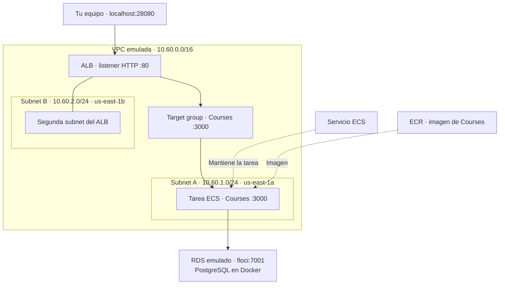

# Floci: laboratorio AWS local

Ejecutar **Courses** con ECS, ALB, ECR y PostgreSQL emulados por Floci. Flyway crea las tablas y StackPort permite inspeccionar recursos. Todo se ejecuta en Docker, sin utilizar AWS real.

## Archivos

| Archivo | Función |
| --- | --- |
| [compose.yaml](compose.yaml) | Floci, StackPort, red Docker y puertos locales. |
| [compose.images.yaml](compose.images.yaml) | Construcción y publicación de las imágenes de Courses y Flyway. |
| [.env.example](.env.example) | Modelo de las variables de configuración. |
| [.gitattributes](.gitattributes) | Conserva `.env.example` con saltos de línea compatibles con Bash también en Windows. |
| [terraform/vpc.tf](terraform/vpc.tf) | VPC y dos subnets; Courses utiliza la primera y el ALB ambas. |
| [terraform/ecr.tf](terraform/ecr.tf), [terraform/rds.tf](terraform/rds.tf) | Repositorios de imágenes y PostgreSQL. |
| [terraform/ecs.tf](terraform/ecs.tf), [terraform/ecs-courses.tf](terraform/ecs-courses.tf) | Clúster, definición de tarea, servicio ECS y reglas de red de Courses. |
| [terraform/alb.tf](terraform/alb.tf) | ALB, listener HTTP, target group y reglas de red del balanceador. |
| [terraform/versions.tf](terraform/versions.tf), [terraform/providers.tf](terraform/providers.tf), [terraform/variables.tf](terraform/variables.tf) | Versiones, conexión con Floci y entradas de Terraform. |

## Ejecución desde cero

Requisitos: Docker en ejecución, Docker Compose, Terraform, AWS CLI, Bash y el repositorio `paideia-poc-microservices-nest` clonado. Desde la raíz de `paideia-infra-config`, entrar en el laboratorio y ejecutar allí los siguientes pasos:

```bash
cd environments/local/floci/aws/ecs/paideia-poc-microservices-nest
```

### 1. Configurar

Crear `.env` sin sobrescribirlo si ya existe:

```bash
[ -f .env ] || cp .env.example .env
```

Editar estos valores:

| Variable | Configuración |
| --- | --- |
| `MICROSERVICES_PATH` | Ruta al repositorio que contiene `courses/`, relativa a esta carpeta o absoluta. |
| `TF_VAR_courses_db_password` | Contraseña local de PostgreSQL; conservarla si la base ya existe. |
| `TF_VAR_courses_version` | Tag de ambas imágenes; inicialmente `0.1.0`. |
| `TF_VAR_courses_replicas` | Comenzar con `0` hasta publicar las imágenes y migrar la base. |

Conservar inicialmente los demás valores del ejemplo: región `us-east-1`, credenciales ficticias `test` y parámetros de la base. Cargar `.env` en la terminal:

```bash
set -a
source .env
set +a
```

Repetir estos tres comandos en cada terminal nueva y después de editar `.env`. Compose carga el archivo automáticamente; AWS CLI y Terraform necesitan las variables exportadas. No duplicarlas en `terraform.tfvars`.

### 2. Crear la infraestructura

Con las réplicas en `0`:

```bash
docker compose up -d --wait --wait-timeout 180
terraform -chdir=terraform init
terraform -chdir=terraform validate
terraform -chdir=terraform plan
terraform -chdir=terraform apply
```

Revisar los cambios y confirmar al aplicar. Terraform crea también el ALB y el servicio ECS; todavía no ejecuta Courses porque sus réplicas son cero.

### 3. Construir y publicar las imágenes

```bash
docker compose -f compose.images.yaml build

aws --endpoint-url http://localhost:4566 \
  ecr get-login-password |
  docker login --username AWS --password-stdin localhost:4566

docker compose -f compose.images.yaml push
```

Se publican en ECR emulado la aplicación y Flyway con sus migraciones. ECR tiene tags inmutables: usar un tag nuevo si cambia el contenido. En una instalación ya preparada, omitir este paso si ambas imágenes del tag seleccionado siguen publicadas.

### 4. Migrar PostgreSQL

```bash
docker run --rm \
  --network paideia-poc-microservices-nest-local-aws-network \
  -e FLYWAY_URL="jdbc:postgresql://floci:${TF_VAR_courses_db_port}/${TF_VAR_courses_db_name}?sslmode=disable" \
  -e FLYWAY_USER="$TF_VAR_courses_db_username" \
  -e FLYWAY_PASSWORD="$TF_VAR_courses_db_password" \
  "localhost:4566/000000000000/${AWS_REGION}/paideia-poc-microservices-nest-courses-migrate:${TF_VAR_courses_version}" \
  -connectRetries=30 migrate
```

Esperar el resultado correcto de Flyway. Solo aplica migraciones pendientes; el contenedor temporal se elimina al terminar. Desde los contenedores, la base se alcanza mediante `floci`; desde el equipo, mediante `localhost`.

### 5. Iniciar Courses

Cambiar `TF_VAR_courses_replicas=1` en `.env`, recargarlo como en el paso 1 y aplicar:

```bash
terraform -chdir=terraform plan
terraform -chdir=terraform apply
```

Consultar hasta tener una tarea activa y cero pendientes:

```bash
aws --endpoint-url http://localhost:4566 \
  ecs describe-services \
  --cluster paideia-poc-microservices-nest-local-floci-cluster \
  --services paideia-poc-microservices-nest-courses-local-floci \
  --query 'services[].{Estado:status,Deseadas:desiredCount,Activas:runningCount,Pendientes:pendingCount}' \
  --output table
```

### 6. Comprobar el ALB y la aplicación

```bash
courses_target_group=$(aws --endpoint-url http://localhost:4566 \
  elbv2 describe-target-groups \
  --names paideia-nest-floci-courses \
  --query 'TargetGroups[0].TargetGroupArn' \
  --output text)

aws --endpoint-url http://localhost:4566 \
  elbv2 describe-target-health \
  --target-group-arn "$courses_target_group" \
  --query 'TargetHealthDescriptions[].{IP:Target.Id,Puerto:Target.Port,Estado:TargetHealth.State}' \
  --output table
```

Esperar un destino `healthy` en el puerto `3000`; si aparece `initial`, repetir la segunda consulta tras unos segundos. Luego probar:

```bash
curl --fail http://localhost:28080/health
curl --fail http://localhost:28080/courses
```

Resultados esperados: salud con `status: ok` y una lista paginada de cursos, posiblemente vacía. Una respuesta HTTP correcta no sustituye la comprobación `healthy` del ALB.

## Acceso y pausa

| Componente | Dirección |
| --- | --- |
| Courses mediante ALB | http://localhost:28080/health y http://localhost:28080/courses |
| StackPort | http://localhost:20800 |
| API de Floci | http://localhost:4566 |
| PostgreSQL | Host `localhost`; puerto, base y usuario definidos en `.env`. |

**Pausar:** poner las réplicas en `0`, recargar `.env`, aplicar Terraform y ejecutar `docker compose stop`. Los contenedores auxiliares de Floci, como PostgreSQL, pueden seguir activos: comprobarlos en Docker Desktop o con `docker ps`.

**Reanudar:** ejecutar `docker compose up -d --wait --wait-timeout 180`, restaurar las réplicas a `1`, recargar `.env`, aplicar Terraform y comprobar el paso 6. Conservar el estado y los volúmenes; las imágenes y migraciones solo requieren los pasos 3 y 4 cuando corresponda.

`.env` y `terraform/terraform.tfstate` quedan fuera de Git; el estado puede contener la contraseña. Los puertos de Compose están limitados a este equipo. Floci reenvía las peticiones del ALB, pero no aplica sus Security Groups como AWS real.

## Recorrido

Terraform crea los recursos; Docker construye y publica las imágenes; ECS ejecuta la versión seleccionada. El ALB recibe las peticiones y las dirige a Courses. Publicar una imagen no actualiza por sí solo la tarea ECS.


