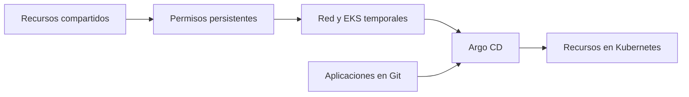

# Sandbox AWS

Escenario de aprendizaje con AWS real: **EKS + Argo CD**, en `us-east-2`, con el clúster `paideia-code-sandbox`. Utiliza un nodo y despliega el piloto Nest desde Git.

## Capas

| Capa | Responsabilidad | Aplicación de cambios |
| --- | --- | --- |
| [shared](shared/terraform/README.md) | Bucket de estados, repositorios ECR y usuario publicador de imágenes. | Manual con Terraform. |
| [persistent](eks-argocd/terraform/persistent/README.md) | Operador, roles y permisos exclusivos de EKS. | Manual con Terraform. |
| [temporary](eks-argocd/terraform/temporary/README.md) | Red, clúster, nodos y acceso a Kubernetes. | Workflows de arranque y retirada. |
| [argocd](eks-argocd/argocd/README.md) | Instalación de Argo CD y registro de la aplicación raíz. | Helm y kubectl desde el workflow de arranque. |
| [applications](eks-argocd/applications/README.md) | Aplicaciones hijas y manifiestos de Kubernetes. | Sincronización automática desde Git mediante Argo CD. |



Las tres configuraciones Terraform guardan estados independientes en el mismo bucket S3. La retirada del entorno destruye la infraestructura temporal y conserva los recursos compartidos y persistentes.

## Preparación y operación

| Momento | Acción |
| --- | --- |
| Preparación de la cuenta | Disponer del bucket del backend, acceso AWS para administrar las capas manuales y una sesión autenticada. El bucket debe existir antes de inicializar el backend S3. |
| Preparación del escenario | Aplicar `shared` y `persistent`; configurar variables y secretos de GitHub según la [guía de workflows](../../../.github/workflows/README.md). |
| Dependencia de automatización | Publicar la versión de `paideia-infra-automations` referenciada por los workflows consumidores. |
| Arranque | Ejecutar **Comprobar identidad** y después **Levantar sandbox**, desde `main`. |
| Cambios de aplicaciones | Publicar cambios en los manifiestos de Git; Argo CD los sincroniza según la política de cada Application. |
| Retirada | Ejecutar **Retirar sandbox**, confirmando `paideia-code-sandbox`. |

El arranque espera nodos preparados y aplicaciones `Synced` y `Healthy`, y después retira el acceso temporal del runner. Un fallo puede dejar una creación parcial o acceso pendiente de retirar; revisar el resultado antes de reintentar.

## Acceso desde el equipo local

La IP del equipo debe coincidir con `SANDBOX_ADMIN_CIDR`. Con el clúster levantado, preparar las credenciales y el contexto local:

```bash
aws login --profile default
aws eks update-kubeconfig --profile default --region us-east-2 --name paideia-code-sandbox --alias paideia-sandbox
```

Mantener cada túnel abierto en una terminal diferente:

```bash
kubectl --context paideia-sandbox -n argocd port-forward svc/argocd-server 20443:443
```

```bash
kubectl --context paideia-sandbox -n paideia-template-nest-layered port-forward svc/paideia-template-nest-layered 23000:3000
```

| Servicio | Dirección local |
| --- | --- |
| Argo CD | [https://localhost:20443](https://localhost:20443) |
| Salud del piloto | [http://localhost:23000/health](http://localhost:23000/health) |

Estos accesos dependen del equipo y del túnel; no son enlaces públicos compartibles. Si el pod al que conecta un túnel se reemplaza, reiniciar ese `port-forward`.
